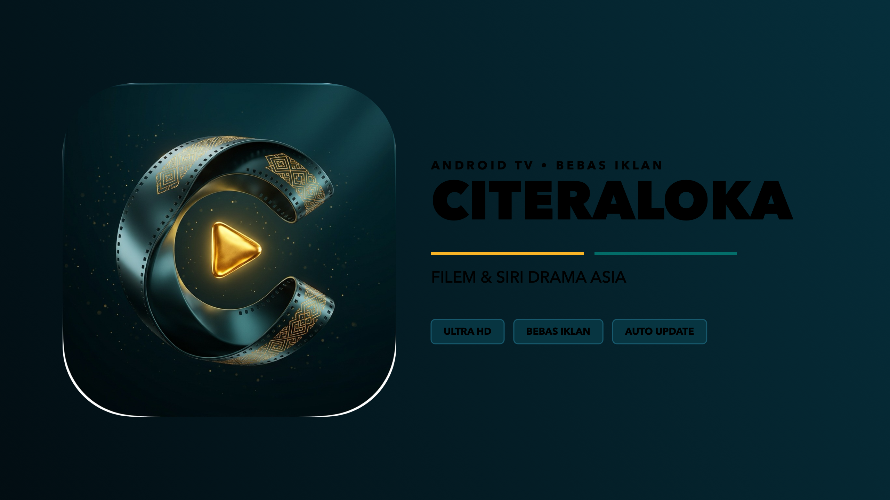

# 🎬 CiteraLoka — Aplikasi Penstriman Android TV & Telefon (Bebas Iklan)

<p align="center">
  
</p>

**CiteraLoka** ialah aplikasi hiburan dan penstriman kandungan filem serta siri drama dengan tema gelap **Dark Teal** minimalis, direka khas untuk keselesaan tontonan pada Android TV, Google TV, Mi Box, dan telefon pintar.

---

## ✨ Ciri-Ciri Utama Terkini (CiteraLoka v3.2)

1. **Identiti Visual Rasmi (Batik Gold 'C' & TV Banner 16:9)**
   * **Ikon Aplikasi Eksklusif:** Menggunakan reka bentuk 3D reben filem melengkung huruf **'C'** bertatahkan corak songket / batik emas dengan butang play segi tiga 3D bercahaya di tengah-tengah latar *Dark Teal*.
   * **Android TV Leanback Banner Rasmi:** Banner paparan 16:9 beresolusi tinggi (*Ultra HD*) khas untuk baris aplikasi Leanback pada Android TV, Google TV, dan Mi Box.
   * **Integrasi Bar Tajuk Aplikasi:** Lambang Batik Gold 'C' dipaparkan bersebelahan nama CiteraLoka pada bar navigasi atas.

2. **Sistem In-App Auto-Update & Remote Config (OTA)**
   * **Kemas Kini 1-Klik Tanpa Perlu Downloader:** Apabila ada versi baharu, dialog kemas kini akan muncul secara automatik. Pengguna hanya perlu klik "KEMAS KINI" dan app akan memuat turun serta memasang APK baharu secara terus.
   * **Butang Semakan Manual:** Butang `KEMAS KINI` tersedia di bar kategori atas untuk menyemak kemas kini bila-bila masa.
   * **Penyelarasan Domain Automatik:** Sekiranya domain asal disekat, app akan menyelaraskan `base_url` baharu secara senyap melalui `config.json` di GitHub tanpa memerlukan pengguna memasang semula app.

2. **Antara Muka Sleek Minimalis (Tanpa Emoji)**
   * Bar kategori berbentuk kotak minimalis (*Box & Name*): `TERBARU`, `UTAMA`, `UNGGULAN`, `POPULER`, `SIRI TV`, `2026`, `BARAT`, `KOREA`, `ACTION`, `HORROR`, `SCI-FI`, `CARIAN`, `DOMAIN`, `KEMAS KINI`.
   * Tiada ikon emoji serabut; tipografi kemas dengan efek fokus aksen *Electric Teal*.

3. **Pemain Video Minimalis & Tetapan Standard Lengkap**
   * Kawalan pemain video kemas tanpa emoji: `PLAY`, `PAUSE`, `+10s`, `-10s`, `+30s`, `-30s`.
   * **Kawalan Suara Bersepadu:** `VOL +`, `VOL -`, `MUTE` dengan paparan peratusan audio pada skrin.
   * **Kelajuan Strim (Playback Speed):** Pilihan `0.75x`, `1.0x`, `1.25x`, `1.5x`, `2.0x`.
   * **Nisbah Skrin (Aspect Ratio):** Pilihan `FIT`, `ZOOM`, `FILL`.
   * **Tukar Server & Episod Langsung:** Tukar pelayan (*P2P*, *CAST*, *HYDRAX*) atau tukar episod terus dalam pemain video.

4. **Bahagian Sambung Menonton (Continue Watching)**
   * Mengingati kedudukan detik terakhir tontonan anda secara automatik.
   * Kad paparan khas dengan bar kemajuan (*progress bar*) hijau-teal dan baki masa.
   * Klik kad untuk terus sambung tonton dari saat terakhir.

5. **Algoritma Cadangan Pintar (User Recommendation Engine)**
   * Sistem cadangan peribadi (*Disyorkan Untuk Anda*) yang mengkaji tabiat tontonan anda:
     * **Padanan Genre (3.5x):** Menjejaki genre kegemaran (Action, Thriller, Korea, dll.).
     * **Padanan Rantau (2.5x):** Menyesuaikan pilihan negara/bahasa.
     * **Pengaruh Rating IMDb & Tajuk Terkini:** Mengutamakan cerita berkualiti tinggi dan rilisan 2025/2026.
     * **Penemuan Baharu:** Mengelakkan cerita yang sudah selesai ditonton daripada diulang tayang.

---

## 📲 Cara Pasang di Android TV / Telefon

### Pilihan A: Pasang Terus Melalui Fail APK
1. Buka aplikasi **Downloader** di Android TV / pelayar web di telefon anda.
2. Masukkan URL muat turun:
   ```text
   https://github.com/syaqirselamanya/lk21-tv-app/releases/download/latest/CiteraLoka.apk
   ```
3. Pasang dan nikmati tontonan CiteraLoka.

### Pilihan B: Pasang Melalui Cloudstream
1. Buka aplikasi **Cloudstream** di TV atau telefon anda.
2. Pergi ke **Settings > Extensions > Add Repository**.
3. Masukkan URL:
   ```text
   https://raw.githubusercontent.com/syaqirselamanya/lk21-tv-app/builds/repo.json
   ```
